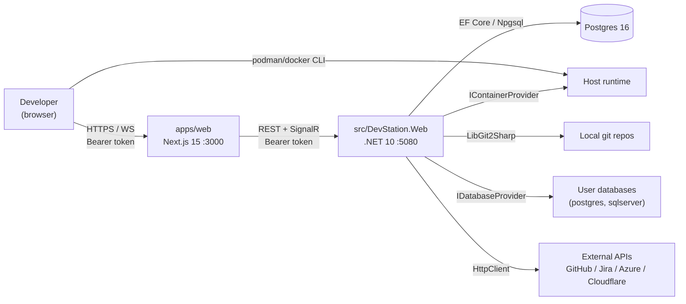
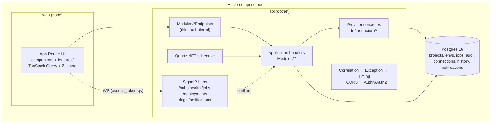

# Architecture overview

DevStation is a **modular monolith**: one deployable .NET 10 API + one
Next.js web app + Postgres. Modules are sliced by feature area inside shared
projects rather than split into services — deployment is a single `dotnet
run`, but the internal boundaries are strict (see `AGENTS.md`).

## Context

## Containers (deployables)

## Layer rules

| Layer | Contains | May not contain |
|---|---|---|
| `Domain` | entities, enums, value objects | EF, HTTP, DI, I/O |
| `Application` | handlers, DTOs, provider + port interfaces, guardrails | EF Core, concrete providers, ASP.NET |
| `Infrastructure` | `DevStationDbContext` + migrations, provider concretes, `EnvSecretStore`, `AuditWriter`, `LogBuffer`, SignalR notifier impls | endpoints |
| `Web` | endpoint maps, auth scheme/policies, middleware, hubs | business logic |

## Request path

`CorrelationIdMiddleware` (assigns/echoes `X-Correlation-Id`) →
`ApiExceptionMiddleware` (`AppException` → `{error:{code,message}}`) →
`RequestTimingMiddleware` (Information log: method path status ms; `/health`
skipped) → CORS (loopback origins only) → `DevToken` auth → tier policy →
endpoint → handler → provider/db → `ApiResult.Ok` envelope.

## Live updates

SignalR hubs share the Bearer auth (token via `access_token` query param for
the browser client). Notifier ports (`IHealthCheckNotifier`,
`IDeploymentNotifier`, `IJobNotifier`, `ILogNotifier`,
`INotificationNotifier`) are called by handlers/hosted services and bridge to
`SignalR*Notifier` implementations that push to connected clients; the web
client folds pushes into TanStack Query caches.

## Safety model

- Tiers: `read` (default for `/api/*`) < `execute` (mutations) < `deploy`
  (prod deploys) < `admin` (integrations config). Main token = admin; extra
  tokens via `DevStation:TokenTiers:<token>`.
- `ConfirmGate.Require(confirm)` on destructive endpoints; UI mirrors with
  `ConfirmDialog`.
- `SqlGuard` classifies SQL read/write/dangerous; per-connection `readOnly`,
  `MaxRows`, `TimeoutSeconds`; prod-linked connections block writes.
- Every action lands in `AuditEvents` (timestamp, user, action, resource,
  result, metadata — no secrets).
- Secrets live behind `ISecretStore` (`DEVSTATION_SECRET_*` env baseline +
  in-memory runtime values with delete tombstones).

## Observability

- `RequestTimingMiddleware` logs every request at Information.
- In-app log buffer (`/api/logs` + `/hubs/logs` live tail).
- Opt-in OpenTelemetry: `Observability:OpenTelemetry:Enabled=true` or
  `OTEL_ENABLED=true` → ASP.NET Core traces + metrics via the **console
  exporter only** (no OTLP dependency shipped).

See `modules.md` for the per-area map, `../api/reference.md` for the
endpoint table, `../decisions/` for the ADRs.
